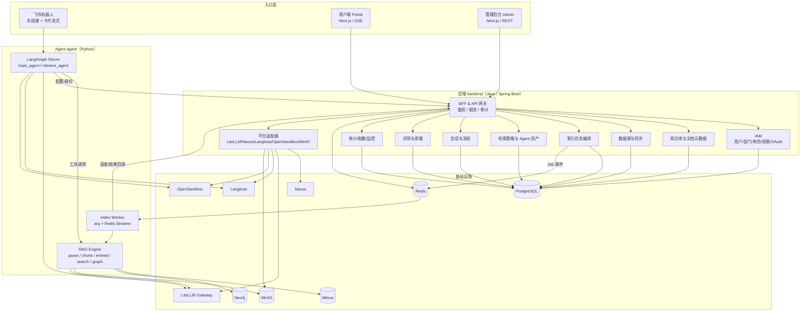
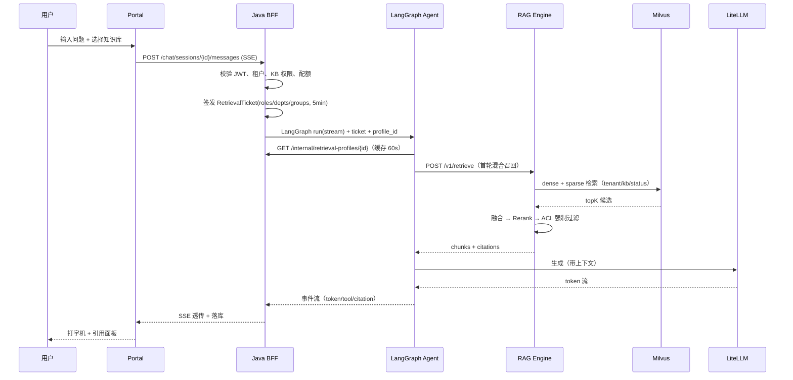
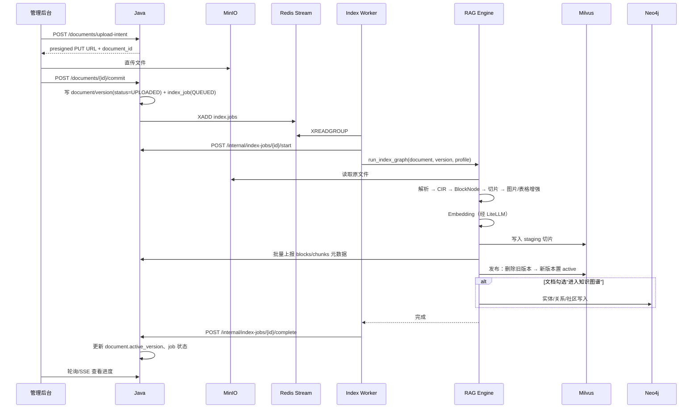
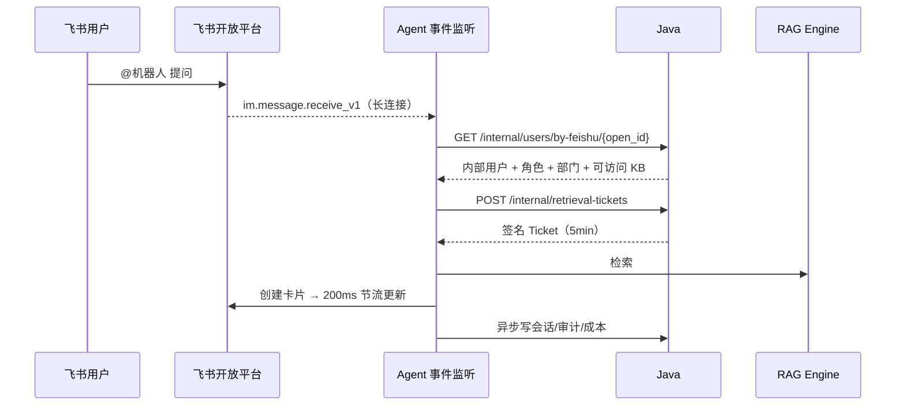
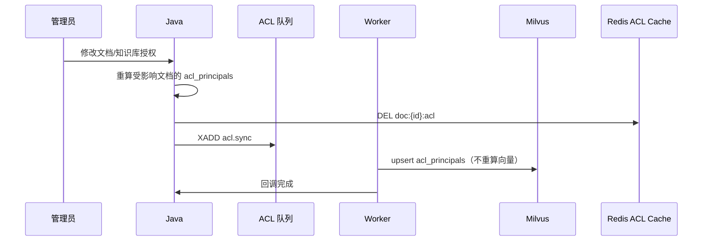

# 01 总体架构与实现方案

## 1. 目标与边界

构建一套企业内部可私有化部署的 **AI 知识中枢**：用户通过飞书或 Web 对话获取基于企业知识库的答案；管理员通过管理后台完成知识库、数据源、权限、索引、检索策略、Agent 资产、评测与审计的统一管理。

**四条产品线**（与你的划分一致）：

1. 前台 `portal`：用户对话与知识消费。
2. 后台 `admin`：管理与治理界面，只调后端接口。
3. 后端 `backend`：Java 控制面，唯一事实源。
4. Agent `agent`：Python 智能体与 RAG 引擎。

## 2. 设计原则

| 原则 | 落地方式 |
| --- | --- |
| 单一事实源 | 业务元数据只在 Postgres；Milvus/Neo4j 是可重建的派生索引 |
| 控制面与数据面分离 | 配置、权限、凭证、审计走 Java；大流量检索/向量读写走 RAG Engine |
| 重活不进 Java | 解析、OCR、切片、Embedding、图谱抽取全部在 Python |
| 权限不可由模型决定 | ACL 由签名票据注入，检索层强制拼接过滤条件 |
| 一切异步 | 解析/索引/图谱/评测都是 Job，可重试、可观测、可断点 |
| 可替换 | 模型、Embedding、Reranker、向量库、图谱库、解析器均为适配器 |
| 默认安全 | 租户隔离、最小权限、密钥不出后端、检索结果必须带引用 |

## 3. 总体架构



### 3.1 四端职责边界

| 端 | 负责 | 不负责 |
| --- | --- | --- |
| 前台 Portal | 对话交互、流式渲染、引用展示、反馈、历史 | 任何权限判定、任何直连中间件 |
| 后台 Admin | 可视化配置、审核、调试、观测 | 业务规则计算、直接读写 Milvus |
| 后端 Java | 身份/权限/元数据/任务/配置/审计/配额、平台 API 封装 | 文档解析、向量计算、LLM 调用编排 |
| Agent Python | 对话推理、工具调用、检索执行、索引流水线、图谱抽取 | 用户与权限事实源、计费结算 |

### 3.2 为什么 Agent 内部要拆 `LangGraph Server` 和 `RAG Engine`

- LangGraph Server 的强项是**有状态对话、流式事件、检查点、HITL**，不适合跑几十分钟的解析/OCR/Embedding 批任务。
- RAG Engine 是**无状态、可水平扩展的算力服务**，接口是 `/retrieve`、`/graph/query`、`/index/*`，可被 Agent 工具调用，也可被 Worker 调用。
- 同一代码库、两个容器，共享 `rag/` 与 `config/`，避免逻辑分叉；对 Java 只暴露“任务”和“检索”两类契约。

## 4. 关键链路

### 4.1 Web 用户提问（流式）



要点：

- **SSE 透传**：Nginx `proxy_buffering off`、`X-Accel-Buffering: no`、心跳 15s、超时 ≥ 300s。
- **首字延迟目标**：P95 < 2.5s（不含排队），检索 P95 < 800ms。
- **落库责任在后端**：Agent 只发事件，Java 负责消息、引用、Token、成本的持久化，保证后台可审计。

### 4.2 文档上传 → 自动入库（对应你的问题 7）

**结论：必须由后台调用 Agent 的完整索引流程，Java 不做解析和向量化。**



设计细节：

- **上传直传 MinIO**：浏览器拿预签名 URL，Java 不转发大文件。
- **任务解耦**：Java 只写 `index_jobs` + Outbox，Publisher 投递 Redis Stream；Worker 消费并回调。失败进 DLQ，可人工重试。
- **解析产物两级存储**：Block 树与切片全文快照写 MinIO（`blocks/{doc}/{version}.json`），Postgres 只存可检索的元数据（切片 id、序号、标题路径、类型、token 数、hash、状态），避免大 JSON 打爆数据库。
- **发布原子性**：staging → 删除旧版本 → active；允许 5s 内最终一致，检索层过滤 `status == "active"`。
- **幂等**：`content_hash` 未变则跳过；同一 `document_id + version` 重复消费直接返回成功。

### 4.3 飞书消息



- 飞书入口**直连 Agent**（沿用参考项目 `feishu/event` 长连接方案），Java 只做身份映射、票据、审计。
- 未绑定用户 → 访客角色，只能访问 `public` 知识库；绑定入口放 Portal“账号绑定”。
- 卡片交互（点赞/追问/展开引用）走 `card.action.trigger` 回调。

### 4.4 权限变更传播



**关键点：权限变更只更新 ACL 字段，不重新 Embedding。** 内容与权限解耦。

## 5. 平台连接方式（对应你的问题 4）

你的直觉是对的：**不要让 Agent 各自散着连一堆平台**。但“全部经过 Java 代理”也不对，会把 Java 变成向量流量瓶颈。

最终方案：**控制面统一、数据面受控直连**。

| 平台 | 谁调用 | 方式 | 原因 |
| --- | --- | --- | --- |
| LiteLLM | Agent / RAG Engine | 直连网关，使用租户级 Virtual Key | LLM 流量大、需流式；网关本身能做预算与限流 |
| Nacos | Agent 读，Java 写 | Agent 只读命名空间；管理端通过 Java 调 Nacos API | Prompt/Skill/MCP/AgentSpec 需要热更新 |
| Langfuse | Agent 写 Trace，Java 读 | 双套 Key：ingest key / read key | 写入量大；后台只做查询与评测 |
| MinIO | 前端直传、Agent 预签名读 | Java 签发短期预签名 URL | 避免大文件过 Java |
| Milvus | RAG Engine | 专用只读写账号 + 网络隔离 + 强制 ACL | Java 代理向量结果不现实 |
| Neo4j | RAG Engine | 专用账号 | 同上 |
| OpenSandbox | Agent | 服务 Token | 仅 Agent 使用 |
| Redis/Postgres | Java 独占；RAG 只读配置缓存 | 独立库/独立账号 | 边界清晰 |

**收益**：配置只改一处（Java），凭证只在 Java 加密存储，审计有统一入口；同时避免 Java 代理 GB 级向量数据。

详见 [09-ADR](./09-ADR-平台连接方式评估.md)。

## 6. 技术选型

| 层 | 选型 | 理由 |
| --- | --- | --- |
| 后端 | Java 21 + Spring Boot 3.5 | 生态成熟、企业私有化常见、招人容易 |
| ORM/迁移 | MyBatis-Plus + Flyway | 复杂查询可控；迁移可审计 |
| 数据库 | PostgreSQL 17 | JSONB、全文、行级安全、成熟运维 |
| 缓存/队列 | Redis 7（Streams + 分布式锁 + 限流） | 一物多用，减少组件 |
| 对象存储 | MinIO | 私有化标准，S3 兼容 |
| 向量库 | Milvus 2.5+/3.x Standalone | 已有实践；稠密+BM25 稀疏混合；ARRAY 过滤 |
| 图谱 | Neo4j 5 Community | Cypher 生态；社区发现用 Python |
| Agent | Python 3.13 + LangGraph + Deep Agents | 与参考项目一致，可复用 |
| Agent 运行时 | LangGraph Server | 检查点、流式、HITL、Studio 调试 |
| 任务队列 | arq（Redis） | 轻量异步，够用；后续可换 Celery/RabbitMQ |
| 网关 | LiteLLM | 多模型、预算、回退、会话粘性 |
| 配置中心 | Nacos 3.x（AI Registry） | Prompt/Skill/MCP/AgentSpec 治理 |
| 可观测 | Langfuse + OpenTelemetry + Prometheus/Grafana | LLM 追踪 + 系统指标 |
| 前端 | Next.js 15 + TypeScript + Ant Design 5 + Tailwind | 管理端组件全；用户端可定制 |
| 前端数据层 | TanStack Query + OpenAPI 生成客户端 | 类型安全、缓存一致 |
| 流式 | SSE（Web 与 Java），飞书卡片节流更新 | 简单、可穿透代理 |
| 部署 | Docker Compose（一期）/ Helm（二期） | 私有化交付友好 |

## 7. 仓库结构（Monorepo）

```text
knowledge-hub/
├── backend/                     # Java 21 / Spring Boot
│   ├── platform-common/         # 结果、异常、租户、TraceId、加密
│   ├── platform-iam/
│   ├── platform-kb/
│   ├── platform-datasource/
│   ├── platform-index/
│   ├── platform-retrieval/      # 策略配置、调试
│   ├── platform-chat/
│   ├── platform-eval/
│   ├── platform-graph/
│   ├── platform-ops/
│   ├── platform-integration/    # LiteLLM/Nacos/Langfuse/MinIO/Sandbox 适配器
│   └── platform-boot/           # 启动模块 + Flyway
├── agent/                       # Python 3.13 / uv
│   ├── src/knowledge_hub/
│   │   ├── agents/              # main_agent / retrieve_agent / graph_agent
│   │   ├── rag/                 # loader / parser / structure / splitter / embed / store
│   │   ├── graphs/              # index_graph / graph_build_graph / eval_graph
│   │   ├── engine/              # FastAPI: /retrieve /graph /index
│   │   ├── worker/              # arq 消费者
│   │   ├── feishu/              # event / api / card
│   │   ├── tools/               # milvus / graph / doc / sandbox
│   │   ├── security/            # ticket 验签、内部服务鉴权
│   │   └── config/
│   ├── langgraph.json
│   └── tests/
├── web/
│   ├── apps/portal/             # 用户端
│   ├── apps/admin/              # 管理端
│   └── packages/ui/             # 设计系统、主题、组件
│   └── packages/api-client/     # OpenAPI 生成
├── deploy/
│   ├── compose/
│   ├── helm/                    # 二期
│   └── nginx/
├── docs/
└── Makefile
```

## 8. 非功能设计

### 8.1 性能目标

| 指标 | 目标 |
| --- | --- |
| 对话首 Token | P95 ≤ 2.5s |
| 检索耗时 | P95 ≤ 800ms（100 万切片/租户） |
| 管理端列表 | P95 ≤ 500ms |
| 索引吞吐 | ≥ 200 页/小时/Worker（纯文本），OCR ≥ 60 页/小时 |
| 并发对话 | 50/Agent 实例，可水平扩展 |
| 可用性 | 99.5%（单机 Compose 基线） |

### 8.2 安全

- JWT RS256；Portal 用 HttpOnly Cookie + CSRF，Admin 同源 BFF；内部服务用签名 JWT + mTLS（二期）。
- 第三方密钥 AES-256-GCM 加密落库，主密钥只从环境变量/KMS 注入，接口永不回显。
- 租户隔离：MyBatis 拦截器强制 `tenant_id`，缺失即抛异常；集成测试覆盖越权用例。
- 上传：MIME 嗅探、大小限制、ZIP 炸弹防护、可选 ClamAV。
- SSRF：URL 导入仅允许白名单域，禁止内网/元数据地址。
- Prompt 注入：检索内容标记为不可信数据、工具白名单、禁止从文档中读取指令、输出引用校验。
- 审计：所有写操作 + 每次检索/对话，保留 180 天，可导出。

### 8.3 可观测

- 全链路 `request_id`：Portal → Java → Agent → RAG Engine → Milvus。
- LLM 追踪：Langfuse（prompt/version/token/cost/latency）。
- 系统指标：Prometheus（QPS、P95、队列积压、索引失败率、Milvus 延迟）。
- 告警：索引连续失败、DLQ 非空、检索零结果率突增、成本日环比 > 30%。

### 8.4 成本控制

- LiteLLM 租户预算 + 平台侧 RPM/TPM 双限流。
- 索引任务并发上限、Embedding 批量、图片理解按需开启。
- GraphRAG 仅精选文档；抽取设最大实体数/Token 上限；夜间批处理。
- 评测/裁判模型只对采样或低置信答案运行。

## 9. 交付顺序（摘要）

1. 基座与契约（登录、租户、审计、Compose、OpenAPI）。
2. 知识库 + 上传 + 索引闭环 + 混合检索 + 权限。
3. 用户端对话 + 管理端核心页面。
4. Agentic RAG + 评测 + 飞书。
5. GraphRAG + 策略配置 + LLM Wiki。
6. 加固上线。

详见 [08-里程碑与工期评估](./08-里程碑与工期评估.md)。
