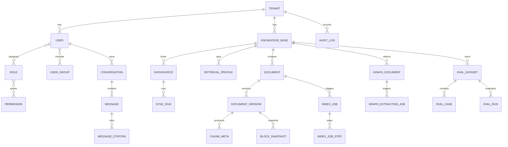

# 03 数据与接口契约

## 1. 存储职责划分

| 存储 | 职责 | 是否可重建 |
| --- | --- | --- |
| PostgreSQL | 租户、用户、权限、知识库、文档元数据、Job、会话、审计、评测、配置 | 否（事实源） |
| Milvus | 切片向量、BM25 稀疏向量、ACL 主体、版本/状态 | 是（可从原文重建） |
| Neo4j | 实体、关系、社区、证据引用 | 是（可重建，成本高） |
| MinIO | 原始文件、Block 树快照、切片快照、图片、导出物 | 否（原件） |
| Redis | 缓存、票据、限流、队列、分布式锁 | 是 |

> 每个服务使用独立数据库与账号：`kh_app`（Java）、`kh_rag`（只读配置 + 回调）、`kh_langgraph`（检查点，可选）。
> Milvus/Neo4j 使用独立账号，Java 不持有其凭证。

## 2. PostgreSQL 核心模型



### 2.1 关键表（字段节选）

```sql
-- 所有业务表统一包含：id uuid pk, tenant_id varchar(64) not null, created_at, updated_at, created_by, updated_by, deleted_at

CREATE TABLE knowledge_base (
  id                uuid PRIMARY KEY,
  tenant_id         varchar(64) NOT NULL,
  name              varchar(128) NOT NULL,
  code              varchar(64) NOT NULL,
  description       text,
  visibility        varchar(16) NOT NULL DEFAULT 'private', -- private|dept|tenant|public
  embedding_model   varchar(64) NOT NULL,
  embedding_dim     int NOT NULL,
  collection_name   varchar(128) NOT NULL,
  default_profile_id uuid,
  chunk_template    varchar(64) NOT NULL DEFAULT 'general',
  graph_enabled     boolean NOT NULL DEFAULT false,
  status            varchar(16) NOT NULL DEFAULT 'active',
  UNIQUE (tenant_id, code)
);

CREATE TABLE document (
  id                uuid PRIMARY KEY,
  tenant_id         varchar(64) NOT NULL,
  kb_id             uuid NOT NULL,
  title             varchar(512) NOT NULL,
  source_type       varchar(32) NOT NULL, -- upload|feishu|wecom|s3|web
  source_ref        varchar(1024),
  source_url        text,
  mime_type         varchar(128),
  size_bytes        bigint,
  content_hash      varchar(64),
  active_version_id uuid,
  visibility        varchar(16) NOT NULL DEFAULT 'inherit',
  acl_mode          varchar(16) NOT NULL DEFAULT 'inherit', -- inherit|restricted
  status            varchar(24) NOT NULL, -- uploaded|indexing|active|failed|offline
  graph_selected    boolean NOT NULL DEFAULT false,
  owner_id          uuid,
  metadata          jsonb NOT NULL DEFAULT '{}'::jsonb
);
CREATE INDEX idx_document_kb ON document(tenant_id, kb_id, status);

CREATE TABLE document_version (
  id                uuid PRIMARY KEY,
  tenant_id         varchar(64) NOT NULL,
  document_id       uuid NOT NULL,
  revision          varchar(128),
  content_hash      varchar(64) NOT NULL,
  parser            varchar(64),
  chunk_template    varchar(64),
  block_snapshot_key text,          -- MinIO object key
  chunk_snapshot_key text,
  chunk_count       int NOT NULL DEFAULT 0,
  token_count       int NOT NULL DEFAULT 0,
  status            varchar(24) NOT NULL, -- staging|active|superseded|failed
  published_at      timestamptz
);

CREATE TABLE chunk_meta (
  id                uuid PRIMARY KEY,
  tenant_id         varchar(64) NOT NULL,
  kb_id             uuid NOT NULL,
  document_id       uuid NOT NULL,
  version_id        uuid NOT NULL,
  chunk_index       int NOT NULL,
  parent_chunk_id   uuid,
  block_id          varchar(64),
  block_type        varchar(32),
  title_path        jsonb,
  content_hash      varchar(64),
  token_count       int,
  quality_flags     text[],
  enabled           boolean NOT NULL DEFAULT true,
  milvus_pk         varchar(64)
);
CREATE INDEX idx_chunk_doc ON chunk_meta(tenant_id, document_id, version_id, chunk_index);

CREATE TABLE index_job (
  id                uuid PRIMARY KEY,
  tenant_id         varchar(64) NOT NULL,
  document_id       uuid NOT NULL,
  version_id        uuid,
  job_type          varchar(32) NOT NULL, -- parse|index|reindex|acl_sync|graph_build|graph_delete
  status            varchar(24) NOT NULL, -- queued|running|succeeded|failed|canceled
  stage             varchar(32),
  progress          int NOT NULL DEFAULT 0,
  attempt           int NOT NULL DEFAULT 0,
  max_attempts      int NOT NULL DEFAULT 3,
  error_code        varchar(64),
  error_message     text,
  started_at        timestamptz,
  finished_at       timestamptz,
  trace_id          varchar(64)
);

CREATE TABLE retrieval_profile (
  id                uuid PRIMARY KEY,
  tenant_id         varchar(64) NOT NULL,
  name              varchar(128) NOT NULL,
  version           int NOT NULL DEFAULT 1,
  config            jsonb NOT NULL,
  is_default        boolean NOT NULL DEFAULT false,
  status            varchar(16) NOT NULL DEFAULT 'draft', -- draft|published|archived
  published_at      timestamptz
);

CREATE TABLE conversation (
  id                uuid PRIMARY KEY,
  tenant_id         varchar(64) NOT NULL,
  user_id           uuid NOT NULL,
  agent_key         varchar(64) NOT NULL,
  kb_ids            uuid[] NOT NULL DEFAULT '{}',
  profile_id        uuid,
  title             varchar(256),
  source            varchar(16) NOT NULL DEFAULT 'web', -- web|feishu|api
  external_id       varchar(128),
  message_count     int NOT NULL DEFAULT 0,
  last_message_at   timestamptz
);

CREATE TABLE message (
  id                uuid PRIMARY KEY,
  tenant_id         varchar(64) NOT NULL,
  conversation_id   uuid NOT NULL,
  role              varchar(16) NOT NULL, -- user|assistant|tool|system
  content           text,
  content_format    varchar(16) NOT NULL DEFAULT 'markdown',
  status            varchar(16) NOT NULL, -- streaming|completed|stopped|failed
  model             varchar(64),
  input_tokens      int,
  output_tokens     int,
  cost_usd          numeric(12,6),
  latency_ms        int,
  trace_id          varchar(64),
  request_id        varchar(64),
  created_at        timestamptz NOT NULL DEFAULT now()
);
CREATE INDEX idx_message_conv ON message(tenant_id, conversation_id, created_at);

CREATE TABLE audit_log (
  id                bigserial PRIMARY KEY,
  tenant_id         varchar(64) NOT NULL,
  actor_id          uuid,
  actor_name        varchar(128),
  action            varchar(64) NOT NULL,
  resource_type     varchar(64) NOT NULL,
  resource_id       varchar(128),
  before            jsonb,
  after             jsonb,
  ip                inet,
  user_agent        text,
  result            varchar(16) NOT NULL,
  error_code        varchar(64),
  request_id        varchar(64),
  created_at        timestamptz NOT NULL DEFAULT now()
);
```

### 2.2 通用约定

- 主键统一 UUID v7（时间有序）。
- 软删除 `deleted_at`，唯一索引带 `WHERE deleted_at IS NULL`。
- 金额 `numeric(12,6)` USD；时间 `timestamptz`。
- 大文本/JSON 快照放 MinIO，Postgres 只存指针与可检索字段。
- 所有跨租户查询必须显式带 `tenant_id`，由 MyBatis 拦截器兜底。

## 3. Milvus Schema

物理集合：`kb_chunks_{dim}`（按 Embedding 维度分集合），`partition_key = tenant_id`。

| 字段 | 类型 | 说明 |
| --- | --- | --- |
| `pk` | VARCHAR(64) PK | `chunk_id` |
| `tenant_id` | VARCHAR(64) | 分区键 + 必填过滤 |
| `kb_id` | VARCHAR(64) | 知识库 |
| `doc_id` | VARCHAR(64) | 文档 |
| `version_id` | VARCHAR(64) | 版本 |
| `chunk_index` | INT64 | 序号 |
| `parent_pk` | VARCHAR(64) | 父切片 |
| `block_id` | VARCHAR(64) | 来源块 |
| `block_type` | VARCHAR(32) | paragraph/table/image/code/... |
| `title_path` | JSON | 标题路径 |
| `text` | VARCHAR(65535) | 开启中文 analyzer，供 BM25 |
| `dense` | FLOAT_VECTOR(dim) | 稠密向量 |
| `sparse` | SPARSE_FLOAT_VECTOR | BM25 Function 生成 |
| `acl_principals` | ARRAY<VARCHAR(128)> | `user:`, `role:`, `group:`, `dept:`, `tenant:all` |
| `visibility` | VARCHAR(16) | `public` 可跳过主体过滤 |
| `status` | VARCHAR(16) | `staging` / `active` |
| `source_url` | VARCHAR(1024) | 引用链接 |
| `source_type` | VARCHAR(32) | 来源 |
| `lang` | VARCHAR(8) | 语言 |
| `tags` | ARRAY<VARCHAR(64)> | 标签 |
| `updated_at` | INT64 | 毫秒时间戳 |

索引：

- `dense`: HNSW, COSINE, `M=16`, `efConstruction=200`
- `sparse`: SPARSE_INVERTED_INDEX, BM25
- 标量：`tenant_id`（分区键）、`kb_id`、`doc_id`、`status`、`acl_principals`（倒排/位图视版本而定）

检索过滤表达式（由 RAG Engine 强制拼接，不接受模型输入）：

```text
tenant_id == "t_001"
and kb_id in ["kb_001","kb_002"]
and status == "active"
and (visibility == "public"
     or ARRAY_CONTAINS_ANY(acl_principals, ["user:u_123","role:staff","group:g_9","dept:d_1"]))
```

> 兼容性：Milvus 版本若不支持 `ARRAY_CONTAINS_ANY`，降级为 `json_contains_any` 或“粗召回 + 元数据后过滤”。上线前必须做一次版本能力探测。

## 4. Neo4j 模型

```cypher
// 节点
(:Tenant {id})
(:KnowledgeBase {id, name})
(:Document {id, title, version_id})
(:Chunk {id, doc_id, text_hash})
(:Entity {
   id, tenant_id, kb_id, name, normalized_name,
   type, description, aliases, embedding, confidence
})
(:Community {id, kb_id, level, summary, size})

// 关系
(:Document)-[:HAS_CHUNK]->(:Chunk)
(:Chunk)-[:MENTIONS {count}]->(:Entity)
(:Entity)-[:RELATED {
   type, description, weight, confidence,
   evidence_chunk_id, source_doc_id
}]->(:Entity)
(:Entity)-[:IN_COMMUNITY]->(:Community)
(:Community)-[:PARENT_OF]->(:Community)
```

约束：

```cypher
CREATE CONSTRAINT entity_id IF NOT EXISTS FOR (e:Entity) REQUIRE e.id IS UNIQUE;
CREATE INDEX entity_name IF NOT EXISTS FOR (e:Entity) ON (e.normalized_name);
CREATE INDEX entity_kb IF NOT EXISTS FOR (e:Entity) ON (e.kb_id);
CREATE VECTOR INDEX entity_vec IF NOT EXISTS
FOR (e:Entity) ON e.embedding
OPTIONS {indexConfig: {`vector.dimensions`: 1024, `vector.similarity_function`: 'cosine'}};
```

## 5. Redis Key 规范

| Key | 类型 | TTL | 用途 |
| --- | --- | --- | --- |
| `kh:t:{tenant}:sess:{sid}` | string | 30m | 会话上下文缓存 |
| `kh:acl:doc:{doc_id}` | hash | 60s | 文档 ACL 缓存 |
| `kh:profile:{id}:{ver}` | string | 5m | 检索策略快照 |
| `kh:lock:index:{doc_id}` | string | 10m | 索引互斥 |
| `kh:rate:u:{uid}:{minute}` | string | 2m | 用户限流 |
| `kh:quota:{tenant}:{day}` | hash | 2d | Token/请求计数 |
| `kh:semcache:{kb}:{hash}` | string | 1h | 语义缓存 |
| `kh:stream:index.jobs` | stream | - | 索引任务 |
| `kh:stream:acl.sync` | stream | - | ACL 同步 |
| `kh:stream:graph.jobs` | stream | - | 图谱任务 |
| `kh:stream:audit` | stream | - | 审计异步落库 |

## 6. 内部 API 契约

### 6.1 Java → Agent（对话）

```http
POST /runs/stream            # LangGraph Server 原生
Authorization: Bearer <service-jwt>
X-Retrieval-Ticket: <jwt 5min>
X-Tenant-Id: t_001
X-Request-Id: ...
Content-Type: application/json

{
  "assistant_id": "main_agent",
  "input": {"messages": [{"role": "user", "content": "..."}]},
  "config": {"configurable": {"thread_id": "...", "kb_ids": ["..."], "profile_id": "..."}},
  "stream_mode": ["messages", "updates", "custom"]
}
```

事件类型（SSE `event:`）：

| 事件 | 负载 |
| --- | --- |
| `token` | `{delta}` |
| `tool_start` / `tool_end` | `{name, args, result_summary, latency_ms}` |
| `citation` | `{index, doc_id, chunk_id, title, url, snippet}` |
| `status` | `{stage}` |
| `error` | `{code, message, retryable}` |
| `done` | `{message_id, usage}` |

### 6.2 Agent → Java（内部）

| 方法 | 路径 | 说明 |
| --- | --- | --- |
| GET | `/internal/v1/users/by-feishu/{open_id}` | 飞书身份映射 |
| POST | `/internal/v1/retrieval-tickets` | 签发检索票据 |
| GET | `/internal/v1/retrieval-profiles/{id}` | 拉取策略（ETag 缓存） |
| GET | `/internal/v1/acl/documents?ids=` | 批量取文档 ACL |
| POST | `/internal/v1/index-jobs/{id}/start` | 任务开始 |
| POST | `/internal/v1/index-jobs/{id}/progress` | 阶段与进度 |
| POST | `/internal/v1/index-jobs/{id}/chunks` | 批量上报切片元数据 |
| POST | `/internal/v1/index-jobs/{id}/complete` | 完成 |
| POST | `/internal/v1/index-jobs/{id}/fail` | 失败 |
| POST | `/internal/v1/conversations/{id}/messages` | 落库 Agent 消息 |
| POST | `/internal/v1/audit/events` | 审计事件（批量） |

鉴权：`Authorization: Bearer <service-jwt>`，`aud=knowledge-hub-backend`，`scope=internal`，5 分钟有效，RS256。

### 6.3 RAG Engine API（供 Agent 与 Worker）

```http
POST /v1/retrieve
{
  "ticket": "<jwt>",
  "kb_ids": ["kb_001"],
  "query": "...",
  "profile": {...},           // 或 profile_id
  "top_k": 8,
  "filters": {"tags": ["..."], "doc_ids": ["..."]},
  "trace_id": "..."
}
→ 200
{
  "chunks": [{
    "chunk_id": "...", "doc_id": "...", "title": "...", "title_path": ["..."],
    "text": "...", "score": 0.83, "source_url": "...", "block_type": "paragraph",
    "highlights": [[12, 40]]
  }],
  "debug": {"dense_ms": 21, "sparse_ms": 18, "rerank_ms": 90, "filtered": 3}
}
```

```http
POST /v1/graph/query
{"ticket":"...","kb_ids":["..."],"query":"...","hops":2,"include_communities":true}
→ {"entities":[...],"relations":[...],"communities":[...],"evidence_chunk_ids":[...]}

POST /v1/index/jobs          # 由 Worker 内部调用，或 Java 直接触发
{"document_id":"...","version_id":"...","object_key":"...","profile":{...}}

POST /v1/graph/build
{"kb_id":"...","document_ids":["..."],"mode":"full|incremental"}

POST /v1/admin/reload        # 配置热更新
```

### 6.4 Java 对外 API（节选）

| 模块 | 方法与路径 |
| --- | --- |
| 认证 | `POST /api/v1/auth/login`、`GET /api/v1/auth/feishu/authorize`、`GET /api/v1/auth/feishu/callback`、`POST /api/v1/auth/refresh` |
| 知识库 | `GET/POST /api/v1/kbs`、`GET/PUT/DELETE /api/v1/kbs/{id}`、`GET /api/v1/kbs/{id}/stats`、`POST /api/v1/kbs/{id}/members` |
| 文档 | `POST /api/v1/documents/upload-intent`、`POST /api/v1/documents/{id}/commit`、`GET /api/v1/documents`、`GET /api/v1/documents/{id}`、`POST /api/v1/documents/{id}/reindex`、`GET /api/v1/documents/{id}/versions`、`GET /api/v1/documents/{id}/blocks`、`GET /api/v1/documents/{id}/chunks` |
| 数据源 | `POST /api/v1/datasources`、`POST /api/v1/datasources/{id}/test`、`POST /api/v1/datasources/{id}/sync`、`GET /api/v1/datasources/{id}/runs` |
| 权限 | `GET/POST /api/v1/users`、`GET/POST /api/v1/roles`、`PUT /api/v1/resources/{type}/{id}/acl`、`POST /api/v1/acl/preview` |
| 索引 | `GET /api/v1/index-jobs`、`POST /api/v1/index-jobs/{id}/retry`、`POST /api/v1/index-jobs/{id}/cancel` |
| 策略 | `GET/POST /api/v1/retrieval-profiles`、`POST /api/v1/retrieval-profiles/{id}/publish`、`POST /api/v1/retrieval-profiles/{id}/test` |
| 对话 | `POST /api/v1/chat/sessions`、`GET /api/v1/chat/sessions`、`POST /api/v1/chat/sessions/{id}/messages`（SSE）、`POST /api/v1/messages/{id}/feedback` |
| 评测 | `POST /api/v1/eval/datasets`、`POST /api/v1/eval/runs`、`GET /api/v1/eval/runs/{id}` |
| 图谱 | `POST /api/v1/graph/documents`、`POST /api/v1/graph/extractions/{id}/retry`、`GET /api/v1/graph/entities`、`POST /api/v1/graph/entities/{id}/review` |
| 审计 | `GET /api/v1/audit-logs`、`GET /api/v1/metrics/overview` |
| 集成 | `GET /api/v1/integrations/models`、`POST /api/v1/integrations/models/sync`、`GET /api/v1/integrations/health` |

### 6.5 错误码

| 码 | HTTP | 含义 |
| --- | --- | --- |
| `AUTH_401` | 401 | 未登录/Token 过期 |
| `AUTH_403` | 403 | 无权限 |
| `TENANT_MISMATCH` | 403 | 跨租户访问 |
| `KB_NOT_FOUND` | 404 | 知识库不存在 |
| `DOC_STATE_INVALID` | 409 | 文档状态不允许该操作 |
| `INDEX_ALREADY_RUNNING` | 409 | 已有索引任务 |
| `UNSUPPORTED_FILE` | 415 | 不支持的文件类型 |
| `FILE_TOO_LARGE` | 413 | 超出大小限制 |
| `QUOTA_EXCEEDED` | 429 | 配额/限流 |
| `RETRIEVAL_TIMEOUT` | 504 | 检索超时 |
| `MODEL_UNAVAILABLE` | 503 | 模型网关不可用 |
| `INTERNAL_ERROR` | 500 | 未预期错误（带 request_id） |

## 7. 事件与 Outbox

```sql
CREATE TABLE outbox_event (
  id          bigserial PRIMARY KEY,
  tenant_id   varchar(64) NOT NULL,
  topic       varchar(64) NOT NULL,   -- index.job.created / acl.changed / graph.build.requested
  payload     jsonb NOT NULL,
  status      varchar(16) NOT NULL DEFAULT 'pending', -- pending|sent|failed
  retry_count int NOT NULL DEFAULT 0,
  next_at     timestamptz NOT NULL DEFAULT now(),
  created_at  timestamptz NOT NULL DEFAULT now()
);
```

- 业务事务内写 Outbox，独立 Publisher 轮询并 `XADD` 到 Redis Stream。
- 消费端幂等：`event_id` 去重表或 Redis SETNX（24h）。
- 失败重试指数退避，超过 5 次进 DLQ（`kh:stream:*.dlq`），后台可见可重放。

## 8. OpenAPI 与前端客户端

- 后端使用 springdoc 输出 `openapi.json`，CI 归档。
- 前端 `packages/api-client` 由 `openapi-typescript` + `openapi-fetch` 生成，禁止手写重复类型。
- 破坏性变更规则：新增可选字段兼容；删除/改类型必须升 `/api/v2`。
- 所有接口返回统一包裹：

```json
{"code": "OK", "message": "success", "data": {}, "requestId": "..."}
```

分页统一：`page`, `pageSize`, `sort`, 返回 `{items, total, page, pageSize}`。
