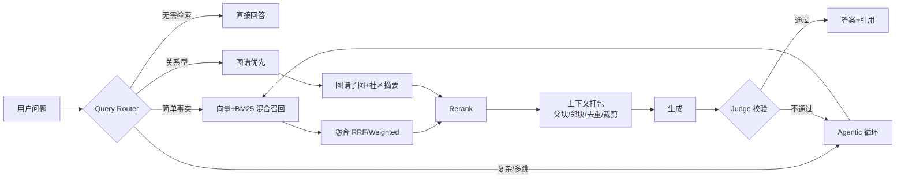
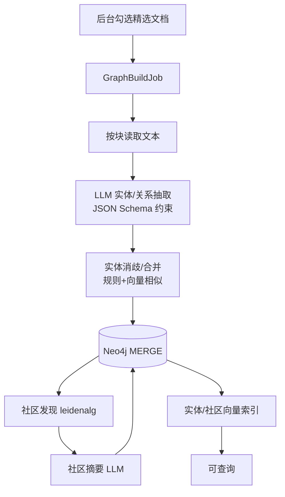

# 05 检索策略配置与 GraphRAG

> 对应你的问题 8：可配置检索方案（Agentic RAG / Agentic+Graph / GraphRAG / LLM Wiki）+ 决策模型。
> 文中把“jev 决策模型”理解为 **Judge/决策模型**（Router + Verifier），如果你的原意不同请指出，我按你的定义调整。

## 1. 设计目标

1. **策略可配置**：同一套代码支持多种检索范式，按知识库/Agent/租户选择，不重启。
2. **可组合**：检索不是 if-else 硬编码，而是一条由阶段组成的 DAG。
3. **可调试**：每次请求能看到每个阶段的输入输出与耗时。
4. **可评估**：策略版本化，能 A/B、能回归。
5. **成本可控**：图谱与多轮检索有硬预算。

## 2. 可组合检索流水线



阶段清单：

| 阶段 | 可选实现 | 说明 |
| --- | --- | --- |
| `guard` | 注入检测、敏感词、越权意图 | 前置 |
| `route` | 规则 / 小模型 / 分类器 | 决定走哪条链路 |
| `rewrite` | 同义改写、HyDE、多查询、指代消解 | 生成 1–3 个查询 |
| `retrieve.vector` | dense HNSW | 语义召回 |
| `retrieve.sparse` | BM25 | 关键词/专有名词 |
| `retrieve.graph` | 实体链接 + k 跳 + 社区 | 关系型问题 |
| `retrieve.exact` | 文档标题/ID/标签精确匹配 | 导航型问题 |
| `fuse` | RRF / Weighted / 模型融合 | 多路合并 |
| `rerank` | Cross-Encoder / LLM Rerank | 精排 |
| `expand` | 父块、相邻块、引用块 | 补上下文 |
| `pack` | 去重、按 token 预算裁剪、排序 | 控制上下文 |
| `generate` | 主模型 | 流式 |
| `verify` | Judge 模型 / 规则 | 忠实度、引用覆盖 |
| `reflect` | 证据缺口 → 再检索 | Agentic 核心 |

## 3. RetrievalProfile 配置

存储于 Postgres `retrieval_profile.config`，由 Java 版本化管理，Agent 通过内部接口拉取并缓存。

```yaml
schemaVersion: 1
name: "深度研究-图谱增强"
strategy: agentic_graph          # direct | hybrid | agentic | agentic_graph | graph_first
guard:
  prompt_injection: true
  pii_masking: false
route:
  enabled: true
  model: "router-small"          # LiteLLM alias
  rules:
    - if: "query.length < 6 && no_entity"
      then: direct
  fallback: hybrid
rewrite:
  enabled: true
  max_variants: 3
  hyde: false
  history_turns: 4
retrieve:
  vector:
    enabled: true
    top_k: 24
    ef: 64
    metric: COSINE
  sparse:
    enabled: true
    top_k: 24
  graph:
    enabled: true
    hops: 2
    entity_top_k: 10
    edge_top_k: 30
    include_communities: true
    max_communities: 3
  exact:
    enabled: true
fuse:
  method: rrf                    # rrf | weighted | model
  rrf_k: 60
  weights: [0.6, 0.3, 0.1]       # dense, sparse, graph
rerank:
  enabled: true
  provider: "bge-reranker-v2"    # 经 LiteLLM /rerank
  top_n: 10
  max_length: 512
expand:
  parent: true
  neighbor: 1
  references: true
  max_expanded: 30
pack:
  max_tokens: 8000
  dedup_threshold: 0.95
  order: "score_then_structure"
generate:
  model: "main-chat"
  temperature: 0.2
  citation_required: true
agent_policy:
  max_rounds: 3
  max_tool_calls: 8
  max_tokens: 30000
  max_latency_ms: 20000
  on_budget_exceeded: partial_answer
verify:
  enabled: true
  model: "judge-small"
  min_faithfulness: 0.7
  citation_coverage: 0.8
  on_fail: one_retry_then_caveat
cache:
  semantic: true
  threshold: 0.95
  ttl_seconds: 3600
observability:
  save_trace: true
  sample_rate: 1.0
```

### 3.1 策略模板

| 模板 | 适用 | 特点 |
| --- | --- | --- |
| 快速问答 `fast` | 客服、FAQ | 仅混合召回 + 轻量 rerank，1 轮，延迟优先 |
| 标准 RAG `hybrid` | 通用 | 混合召回 + rerank + 引用，平衡 |
| Agentic RAG `agentic` | 研究、复杂问题 | 多轮改写/补查，质量优先 |
| 图谱增强 `agentic_graph` | 客户/产品/项目关系 | 文档 + 图谱双路 |
| 图谱优先 `graph_first` | “谁负责/什么关系”类 | 先图后文 |
| 法规合规 `legal` | 合同、制度 | 条款完整、严格引用、拒答保守 |
| 导航 `direct` | 闲聊、指令 | 不检索 |

### 3.2 策略解析优先级

```text
请求显式 profile_id
  > 会话绑定 profile
  > Agent 默认 profile
  > KB 默认 profile
  > 租户默认 profile
  > 系统兜底 hybrid
```

只允许管理员发布 `published` 版本；灰度可按租户/用户群/百分比。

## 4. 决策模型（Router + Judge）

### 4.1 Router：决定“怎么查”

- 输入：问题、最近 2 轮、KB 描述、可用策略列表。
- 输出（结构化 JSON）：

```json
{
  "need_retrieval": true,
  "route": "agentic_graph",
  "kb_ids": ["kb_001"],
  "sub_queries": ["...", "..."],
  "use_graph": true,
  "reason": "问题涉及客户与合同的关系"
}
```

- 实现：
  - P0：规则 + 关键词/正则 + 小模型 few-shot。
  - P1：微调/蒸馏小分类器（3B 以下），延迟 < 100ms。
  - 失败降级：`hybrid`。
- 约束：Router 不能修改 ACL、不能扩大 `kb_ids`（以票据为准，取交集）。

### 4.2 Judge：决定“答得好不好”

- 输入：问题、答案、引用切片。
- 输出：

```json
{
  "faithfulness": 0.86,
  "completeness": 0.72,
  "citation_coverage": 0.91,
  "unsupported_claims": ["..."],
  "verdict": "pass|retry|answer_with_caveat|refuse"
}
```

- 触发时机：所有答案（P0 可只采样 10%）；低置信/长答案/含数字必查。
- 失败动作：再检索一轮 → 仍失败则“部分回答 + 缺口说明”或拒答。
- 用途二：离线评测的自动评分器，与人工标注校准（Cohen's kappa）。

### 4.3 成本控制

| 模型 | 用途 | 建议 |
| --- | --- | --- |
| `router-small` | 路由 | 7B 以下或规则，温度 0 |
| `main-chat` | 生成 | 主力模型 |
| `judge-small` | 校验 | 7–14B，采样 |
| `embedding` | 向量 | 批量 |
| `rerank` | 精排 | GPU 或 API |

预算护栏：单次请求最大 Token、单会话日预算、租户日预算；超限降级而非报错。

## 5. Agentic RAG 循环

```text
首轮：注入混合检索 TopK（中间件，参考 deal_pilot 的 retrieve_context）
  ↓
模型判断：证据是否足够？
  ├─ 足够 → 生成 + 引用
  └─ 不足 → 产出 gap（缺什么）+ 改写 query
        ↓
     调用工具（最多 N 轮）
       - milvus_search(query, filter)：再检索
       - milvus_query(filter)：按已知 ID/块补查
       - graph_query(entity/hops)：关系补查
       - get_doc_url(doc_id)：取原文链接
        ↓
     汇总证据 → 生成
```

提示词要点：

- 明确“首轮材料可能不完整”，鼓励主动补查。
- 工具参数只能用检索结果中出现的真实 ID。
- 每次补查后必须复述新增证据，避免重复检索。
- 证据冲突时列出冲突，不强行统一。
- 达到预算上限时输出“已确认/未确认”。

## 6. GraphRAG（精选文档）

### 6.1 为什么只做“精选”

全量抽取的成本 = 文档数 × 每文档 LLM Token；且噪声大、实体消歧难、维护成本高。因此：

- **全量文档 → Milvus**（覆盖）。
- **精选文档 → Neo4j**（关系深度）。
- 管理后台显式选择哪些文档/目录进入图谱。

### 6.2 构建流程



抽取 Schema：

```json
{
  "entities": [
    {"name": "澄算科技", "type": "Organization", "description": "...", "aliases": ["澄算"], "evidence": "chunk_id"}
  ],
  "relations": [
    {"source": "澄算科技", "target": "智航一体机", "type": "PRODUCES", "description": "...", "weight": 0.8, "evidence": "chunk_id"}
  ]
}
```

约束：

- 实体类型白名单：`Organization/Person/Product/Project/Contract/Policy/Technology/Location/Event`。
- 关系类型白名单或开放但归一化。
- 每文档最大实体数（默认 200）、最大关系数（500）。
- 置信度 < 0.6 进人工审核队列。
- 证据必须指向真实 `chunk_id`，否则丢弃。

### 6.3 增量更新

- 文档更新：删除该文档 `MENTIONS` 的证据边 → 重抽取 → MERGE。
- 实体合并：`MERGE (e:Entity {kb_id, normalized_name})`，保留别名。
- 社区：受影响社区标记 dirty，夜间批量重算；查询时可返回旧摘要并标注 stale。
- 文档移出图谱：删除其证据边；无证据的实体/关系降权或删除。

### 6.4 查询流程

```text
问题
 → 实体链接（NER + 别名 + 向量相似）→ 候选实体 TopK
 → 子图扩展（1–2 跳，按 weight/confidence 裁剪）
 → 社区摘要（包含候选实体的社区，最多 3 个）
 → 与向量检索结果 RRF 融合
 → Rerank → 上下文打包（图谱事实用三元组文本表示，并附证据 chunk）
 → 生成（引用文档 + 图谱证据）
```

三元组文本化示例：

```text
[图谱] 澄算科技 --生产--> 智航一体机（证据：doc_12#chunk_3，置信度 0.82）
```

### 6.5 图谱工具接口

| 工具 | 参数 | 用途 |
| --- | --- | --- |
| `graph_search` | `query, entity_types, limit` | 实体链接与检索 |
| `graph_neighbors` | `entity_id, hops, edge_types, limit` | 邻居扩展 |
| `graph_community` | `entity_id` 或 `community_id` | 社区摘要 |
| `graph_path` | `source_id, target_id, max_hops` | 路径查询 |
| `graph_evidence` | `relation_id` | 证据切片 |

Agent 按需调用，不默认全走图谱。

### 6.6 图谱质量

- 人工审核队列：低置信、冲突关系、孤立实体。
- 评测：关系准确率抽样、答案引用图谱证据比例。
- 可视化：子图浏览，支持按类型过滤、按置信度着色。

## 7. LLM Wiki（知识沉淀）

目标：把“高价值问答 + 人工确认”转成结构化 Wiki 页面，减少重复推理，提升一致性。

流程：

```text
用户高质量问答（点赞/人工标记）
 → 生成 Wiki 草稿（标题、摘要、步骤、注意事项、来源）
 → 审核员编辑/通过
 → 写入 wiki_page 表 + MinIO
 → 作为独立文档重新索引（source_type=wiki）
 → 后续问题优先命中 Wiki，Agent 可直接引用
```

- 与原始文档的关系：Wiki 是“二次加工知识”，原文仍是证据。
- 版本化与回滚同普通文档。
- 防止自我强化：Wiki 生成时强制引用原文，不引用其他 Wiki。

## 8. 调试与评估

### 8.1 检索调试器输出

| 区块 | 内容 |
| --- | --- |
| 输入 | 问题、模拟身份、KB、策略版本 |
| 路由 | route、理由、耗时 |
| 改写 | 原始 query、变体、HyDE |
| 召回 | 每路 topK、分数、命中/过滤数 |
| 融合 | 各路排名与最终排名 |
| Rerank | 前后分数对比 |
| ACL | 被过滤切片及原因 |
| 上下文 | 最终 prompt 片段、token 数 |
| 生成 | 答案、引用、Judge 分数 |
| 总耗时 | 分阶段瀑布图 |

### 8.2 评测指标

| 类别 | 指标 |
| --- | --- |
| 检索 | Recall@k、Precision@k、MRR、nDCG、零结果率 |
| 生成 | 忠实度、完整性、引用准确率、拒答正确率 |
| 图谱 | 实体准确率、关系准确率、证据命中率 |
| 系统 | 首字延迟、总延迟、Token、成本 |
| 业务 | 点赞率、点踩率、追问率、转人工率 |

门禁：新版本对比基线，Recall@5 下降 > 3% 或忠实度下降 > 5% 阻断发布。

## 9. 失败模式与降级

| 失败 | 降级 |
| --- | --- |
| Router 超时 | 使用 `hybrid` |
| 图谱不可用 | 跳过图谱，纯文档检索，答案标注 |
| Rerank 不可用 | 用融合分数排序 |
| 主模型不可用 | LiteLLM 回退链 → 备用模型 |
| Judge 不可用 | 跳过校验，记录未校验 |
| 检索超时 | 返回已获得的部分证据 + 说明 |
| 全部失败 | 明确报错 + request_id，不编造 |
