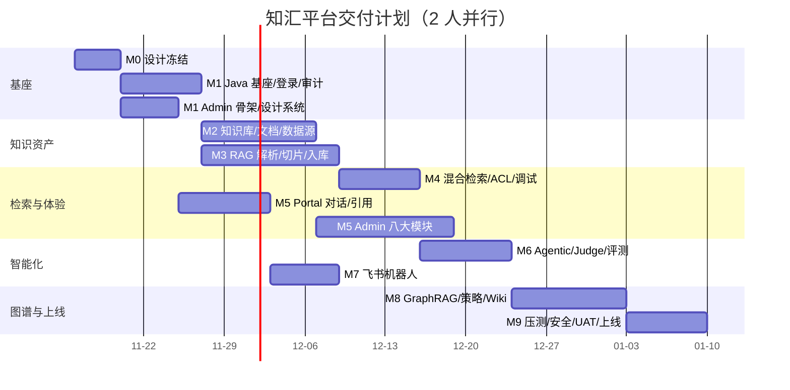

# 08 里程碑与工期评估

> 评估口径：1 人日 = 6 小时有效产出；含设计、编码、自测、联调，不含跨团队等待。  
> “AI 加速”只对样板代码、CRUD、页面、测试生成有效（约 1.5–2×），对架构决策、联调、排障、验收提升有限（约 1.1–1.3×）。以下已按此折算。

## 1. WBS 净工作量

| 阶段 | 任务 | 人日 |
| --- | --- | --- |
| **M0 设计冻结（4）** | 需求评审与边界确认 | 1.0 |
| | 表结构 / DTO / 内部接口冻结 | 1.5 |
| | Monorepo、CI、Compose 骨架 | 1.5 |
| **M1 基座（7）** | Spring Boot 骨架、统一返回/异常/TraceId | 1.0 |
| | IAM：用户/角色/权限/登录/JWT | 2.0 |
| | 租户拦截、审计、限流 | 1.5 |
| | Admin 骨架 + 登录 + 设计系统 | 1.5 |
| | 集成适配器骨架（LiteLLM/Nacos/Langfuse/MinIO） | 1.0 |
| **M2 知识与数据源（10）** | 知识库 CRUD + 成员 | 2.0 |
| | 文档/版本/上传直传 | 2.0 |
| | 数据源框架 + 本地上传 + 飞书读取 | 3.0 |
| | 同步任务/游标/日志 | 1.5 |
| | 资源 ACL + 权限预览 | 1.5 |
| **M3 RAG 索引（10）** | CIR + 解析器（PDF/DOCX/MD/HTML） | 3.0 |
| | Block 树 + 切片模板 | 2.5 |
| | 图片/表格增强 | 1.5 |
| | Embedding + Milvus 写入 + 发布 | 2.0 |
| | Worker + 回调 + 幂等 | 1.0 |
| **M4 检索（7）** | 混合召回 + RRF | 1.5 |
| | Rerank + 上下文打包 | 1.5 |
| | ACL 过滤 + 票据 | 1.5 |
| | 引用与原文链接 | 1.0 |
| | 检索调试 API | 1.5 |
| **M5 前端（12）** | Portal 对话/流式/引用/反馈 | 4.0 |
| | Admin 8 模块列表/表单 | 6.0 |
| | 统一组件/主题/权限路由 | 2.0 |
| **M6 Agent 与质量（8）** | 主 Agent + 工具 | 2.5 |
| | Agentic 循环 + 预算 | 2.0 |
| | Router/Judge | 1.5 |
| | 评测 runner + 指标 + 页面 | 2.0 |
| **M7 飞书（5）** | 应用/长连接/消息 | 1.5 |
| | 卡片流式 | 1.5 |
| | OAuth2 + 身份映射 | 1.0 |
| | 联调/限流/去重 | 1.0 |
| **M8 GraphRAG（10）** | 图谱 Schema/抽取 | 3.0 |
| | 实体消解/写入/增量 | 2.0 |
| | 社区发现/摘要 | 1.5 |
| | 图谱查询 + 融合 + 工具 | 2.0 |
| | 策略配置 UI + LLM Wiki | 1.5 |
| **M9 加固上线（7）** | 压测/性能调优 | 2.0 |
| | 安全测试/修复 | 1.5 |
| | E2E/UAT/缺陷 | 2.0 |
| | 文档/部署/备份 | 1.5 |
| **净工作量** | | **80** |
| **缓冲 20%** | 联调、返工、外部依赖等待 | **16** |
| **合计** | | **96 人日** |

## 2. 排期（2 人并行：1 后端/Agent + 1 前端）

**关键路径**：M0 → M1 → M2/M3 → M4 → M6 → M8 → M9。

## 3. 不同投入下的工期

| 配置 | 工期 | 说明 |
| --- | --- | --- |
| 1 人（你 + AI 子 Agent） | 19–20 周 | 串行为主，前端与后端切换成本高 |
| 2 人（1 后端/Agent + 1 前端） | 12–14 周 | 推荐；前端可并行吃下 M5 |
| 3 人（+1 Agent/算法） | 9–11 周 | M3/M4/M6/M8 可并行，需接口先冻结 |
| 4 人（+1 测试/运维） | 8–9 周 | 边际收益下降，沟通成本上升 |

> 若只交付 **P0 闭环**（M0–M5 + M7 精简，不含 GraphRAG/评测/LLM Wiki）：约 **60 人日**，1 人 12 周 / 2 人 7–8 周。

## 4. 里程碑验收点

| 里程碑 | 可演示内容 | 验收标准 |
| --- | --- | --- |
| G1 基座（第 2 周末） | 登录、租户、审计、Compose | 一键起服务；越权用例通过 |
| G2 知识资产（第 5 周末） | 上传、解析、切片、查看 | 3 种格式索引成功；切片可预览 |
| G3 检索闭环（第 7 周末） | 混合检索、引用、调试台 | Recall@5 ≥ 0.8；权限过滤正确 |
| G4 产品可用（第 9 周末） | Portal 对话 + Admin 8 模块 | 端到端可用；SSE 稳定 |
| G5 智能化（第 11 周末） | Agentic RAG、评测、飞书 | 多跳问题提升；飞书流式卡片 |
| G6 图谱（第 13 周末） | GraphRAG、策略配置、Wiki | 关系型问题可答；策略可切换 |
| G7 上线（第 14 周末） | 压测、安全、UAT | 达到非功能指标；无 P0 缺陷 |

## 5. 风险与缓冲

| 风险 | 概率 | 影响 | 应对 |
| --- | --- | --- | --- |
| 飞书权限/知识库授权踩坑 | 高 | 中 | 第 1 周就做连通性验证；准备轮询兜底 |
| PDF/OCR 解析质量差 | 高 | 高 | 多解析器路由 + 人工修正 + 质量标记 |
| Milvus ARRAY 过滤版本不兼容 | 中 | 高 | 上线前能力探测；准备 postfilter 方案 |
| SSE 经 Nginx 被缓冲 | 中 | 中 | 明确配置；E2E 覆盖 |
| GraphRAG 抽取成本/噪声 | 高 | 中 | 只做精选；限额；人工审核 |
| 权限泄漏 | 低 | 极高 | 票据 + 强制过滤 + 越权测试 + 代码评审 |
| LLM 网关不稳定 | 中 | 中 | LiteLLM 回退链 + 超时 + 降级 |
| 需求蔓延 | 高 | 高 | P0/P1/P2 分级；变更走评审 |
| 前端页面量大 | 中 | 中 | 组件库 + 模板化 CRUD；优先核心页 |
| 多人并行冲突 | 中 | 中 | 目录域隔离；接口先冻结；每日合并 |

## 6. 前置条件（不满足会拖期）

1. 飞书企业自建应用可创建、可发布（管理员配合）。
2. 至少 1 台可跑 Docker 的开发机（建议 16C/32G/500G）。
3. 可用的模型服务（LiteLLM 后端的 OpenAI 兼容端点）与 Embedding/Rerank 模型。
4. 测试用知识库与 50–100 条评测问题。
5. 明确首期租户与用户范围。

## 7. 建议的付款/交付节奏（如对外）

| 阶段 | 交付 | 占比 |
| --- | --- | --- |
| 合同启动 | 方案 + 原型 | 20% |
| G3 检索闭环 | 可演示系统 | 30% |
| G5 智能化 | 飞书 + Agentic | 30% |
| G7 上线 | 验收 + 文档 | 20% |
